<!-- animação da cobrinha nos commits — gerada pelo workflow -->

<h3><code>junior@github ~ $ ./contributions.sh</code></h3>

<picture>
  <source media="(prefers-color-scheme: dark)" srcset="https://raw.githubusercontent.com/JuniorOliveiraj/JuniorOliveiraj/output/github-contribution-grid-snake-dark.svg">
  <source media="(prefers-color-scheme: light)" srcset="https://raw.githubusercontent.com/JuniorOliveiraj/JuniorOliveiraj/output/github-contribution-grid-snake-dark.svg">
  
</picture>

 
 

<!-- portrait ASCII (esquerda) + card de stats (direita) -->
<!-- portrait gerado por: python scripts/prep_photo.py && python scripts/make_ascii_svg.py -->
<!-- stats gerado por: python scripts/render_stats_svg.py (mesmo workflow diário) -->

<h3><code>junior@github ~ $ whoami</code></h3>

<table>
<tr>
<td valign="top"></td>
<td valign="top"></td>
</tr>
</table>

 
 

<h3><code>junior@github ~ $ cat about.txt</code></h3>

 Explorando novas tecnologias e desenvolvendo soluções de software. 
 Formado em Análise e Desenvolvimento de Sistemas. 
 Full Stack Developer na <b>Wiipo</b>. 
 Aprendendo mais sobre C#, .NET, React e Flutter.

 

<h3><code>junior@github ~ $ ./skills.sh</code></h3>

**Aplicações e dados**

**DevOps & Ferramentas**

 

<h3><code>junior@github ~ $ ./links.sh</code></h3>

<b>Full Stack Developer · .NET · React · Flutter</b>

 

